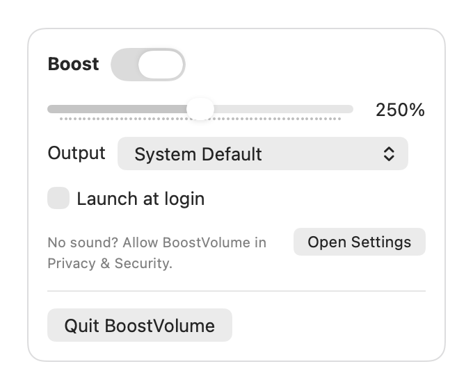

# BoostVolume

A tiny macOS menu bar app that makes system audio louder than the built-in 100% limit — up to 400%, with a limiter so loud audio doesn't clip.

<p align="center">
  <picture>
    <source media="(prefers-color-scheme: dark)" srcset="docs/images/menu-dark.png">
    
  </picture>
</p>

It uses Core Audio process taps (macOS 14.4+): all system audio is captured and muted, boosted, and played to your output device. No audio driver to install.

## Download

1. Download **BoostVolume.zip** from the [latest release](https://github.com/hiepxuan2008/BoostVolumnMac/releases/latest) and unzip it.
2. Move **BoostVolume.app** to your Applications folder.
3. The app isn't notarized by Apple, so the first launch is blocked. Either:
   - open it once, then go to **System Settings › Privacy & Security** and click **Open Anyway**, or
   - run `xattr -dr com.apple.quarantine /Applications/BoostVolume.app` in Terminal, then open it.
4. Click the speaker icon in the menu bar and turn **Boost** on. Allow **System Audio Recording** when macOS asks.

Works on Apple Silicon and Intel Macs running macOS 14.4 or later.

## Using it

Click the speaker icon in the menu bar:

- **Boost** — turn boosting on/off.
- **Slider** — 100%–400%.
- **Output** — "System Default" follows your Mac's output (e.g. switches to headphones when plugged in), or pick a specific device.
- **Launch at login**.

If you hear nothing while boosting, allow BoostVolume in System Settings › Privacy & Security › Screen & System Audio Recording (the menu has an "Open Settings" button).

## Build from source

Requires Xcode / the Swift 6 toolchain.

```bash
./scripts/build-app.sh
open build/BoostVolume.app
```

Run the tests with `swift test`. Set `UNIVERSAL=1` to build for both Apple Silicon and Intel.

`build-app.sh` signs the app ad-hoc by default, which means macOS may ask for the audio permission again after every rebuild. To avoid that, sign with your own identity:

```bash
SIGN_IDENTITY="Apple Development: Your Name (TEAMID)" ./scripts/build-app.sh
```

## Notes

- Capture-and-replay adds roughly 10–20 ms of latency.
- Virtual audio devices (other audio enhancers, loopback drivers) are skipped when choosing the output automatically, because boosting into them can loop audio back or go silent. You can still pick one explicitly; the menu warns you.
